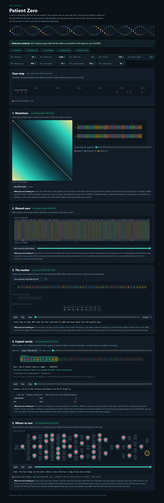

# Assignment 4. Patient Zero

Student ID: 251968
Name:
Group:

This file is the report. Fill it in as you go. How to start: `START_HERE.md`. The task: `docs/Assignment4.pdf`.

## Program output

The 9 lines your program prints on your data (`java -cp out Main`):

    Mutations: 74
    Shared core: 1183
    Marker hits: 7
    First hit: 778
    Border length: 3
    Shared words: 585
    Tests needed: 33
    Cheapest testing: 152
    Longest chain: 35

My outbreak report (a screenshot of `output/outbreak.html`):

## Questions

Answer in your own words, two or three sentences each.

Mission 1. What does the cell d[i][j] of your table mean, and how is it computed from other cells?

The cell `d[i][j]` represents the minimum number of single-letter edits (insertions, deletions, substitutions) needed to transform the prefix of length `i` of strain A into the prefix of length `j` of strain B. It is computed as `d[i][j] = min(d[i-1][j] + 1, d[i][j-1] + 1, d[i-1][j-1] + cost)`, where `cost` is 0 if `A[i-1] == B[j-1]` and 1 otherwise. Thus, each value depends directly on the precomputed optimal solutions of its three adjacent subproblems: deletion (top), insertion (left), and match/replacement (diagonal).

Mission 2. How is the longest common subsequence different from the longest common substring? My Shared core is bigger than the number of letters that are the same at the same place: why?

A subsequence preserves the sequential order of characters without requiring them to be contiguous, whereas a substring requires consecutive, unbroken positions. The Shared core (LCS) is much larger than the count of identical letters at matching indices because mutations such as insertions and deletions shift subsequent bases out of alignment. LCS naturally accounts for these index offsets and discovers the optimal alignment across shifts rather than rigidly comparing identical indices.

Mission 3. What does the prefix function tell you, and why does the pointer in the text never go back in KMP? What is the Border length of my marker and what does it mean?

The prefix function $\pi[i]$ gives the length of the longest proper prefix of `p[0..i]` that is also a suffix of `p[0..i]`. During KMP search, when a mismatch occurs after matching $k$ characters, the text pointer does not move backward because the text already contains a prefix of the pattern; the pattern simply shifts to align its prefix of length $\pi[k-1]$ with the matching suffix, achieving strictly linear $O(n)$ time. For marker `GATCAAGAT`, the Border length is 3, which means the 3-letter prefix `GAT` is identical to the 3-letter suffix `GAT`.

Mission 4. Why must you compare the letters after the hashes are equal? What happens to the cost of Rabin-Karp if many windows have the same hash?

Because the hash function maps arbitrarily many strings into a finite range of modulo integers, two different 12-letter sequences can produce the same hash value (a hash collision); comparing actual characters is essential to prevent false positives. If many windows share the same hash value, the algorithm is forced to verify each candidate window character-by-character, which degrades the average $O(n + m)$ lookup time toward the worst-case $O(n \cdot m)$ time.

Mission 5. What are the two states of a person in your DP, and how do you get the answer for a person from its children? Why does a greedy "test the person with most links first" not always give the cheapest answer?

For each person $v$, the two states are: person $v$ is tested (`take[v]`) and person $v$ is not tested (`skip[v]`). If $v$ is tested, the edge to each child is already covered, so each child may be tested or skipped based on whichever is cheaper (`take[v] = cost[v] + \sum \min(take[c], skip[c])`); if $v$ is not tested, every child must be tested (`skip[v] = \sum take[c]`). A greedy approach fails because a high-degree person may have an excessively high individual testing cost compared to the collective cost of testing all their cheaper neighbours, leading to a suboptimal total cost.

## AI use

The syllabus requires you to say which AI tools you used and for what. Write the tool (ChatGPT, Copilot, other) and what you asked it: explain an idea, find an error, review code. Write "none" if you did not use any. If you took code or text from a book or a website, give the source here.

Antigravity (Gemini 3.8 Flash): Used to assist with project setup, running benchmarks and automated checks, verifying visual output of `outbreak.html` animations against task specifications, and formatting the documentation report.

## Timing (Mission 7)

Milliseconds, average of 3 runs, from `java -cp out Bench`.

| test | size | time |
|---|---|---|
| naive search | 20 000 / 40 000 / 80 000 | 309.9 ms / 546.4 ms / 1054.4 ms |
| KMP | 20 000 / 40 000 / 80 000 | 11.9 ms / 5.0 ms / 2.5 ms |
| edit distance | 500 / 1000 / 2000 / 4000 | 23.9 ms / 32.4 ms / 82.4 ms / 281.8 ms |

What do the numbers say about how the time grows? When you double the size, by how much does each time grow? Two or three sentences.

For naive string search in the worst case where pattern characters repeatedly match until the final character, execution time doubles when text length doubles, growing linearly with text size ($O(n \cdot m)$ with constant $m$). KMP runs in linear $O(n + m)$ time with very low overhead, processing the text in a single pass without backtracking and executing in just a few milliseconds. For edit distance, the $O(n^2)$ time complexity is clearly demonstrated: doubling the string length quadruples the number of cells in the DP table, causing the runtime to increase by a factor of approximately 3.5 to 4 with each doubling.

## Complexity

n is the length of the text (or of a strain), m the length of the pattern, k the length of the window, v the number of people. Fill in every algorithm you wrote.

| algorithm | time | space | assumptions |
|---|---|---|---|
| Edit distance | $O(n \cdot m)$ | $O(n \cdot m)$ | Full DP table of size $(n+1) \times (m+1)$; space can be optimized to $O(\min(n, m))$ if only the distance is needed. |
| LCS | $O(n \cdot m)$ | $O(n \cdot m)$ | Full DP table of size $(n+1) \times (m+1)$ storing lengths of longest common subsequences. |
| Prefix function and KMP | $O(n + m)$ | $O(m)$ | $O(m)$ time and space for prefix function $\pi$; text pointer never backtracks, scanning text of length $n$ in $O(n)$ time. |
| Rabin-Karp (shared words) | Average: $O(n + m)$, Worst: $O(n \cdot m)$ | $O(m)$ | Rolling hash updated in $O(1)$ per window of length $k$; hash table lookup is $O(1)$ on average, with character comparison upon collision. |
| Tree DP | $O(v)$ | $O(v)$ | Tree has $v$ vertices and $v-1$ edges; tree traversal and bottom-up DP visit each node and edge a constant number of times. |

